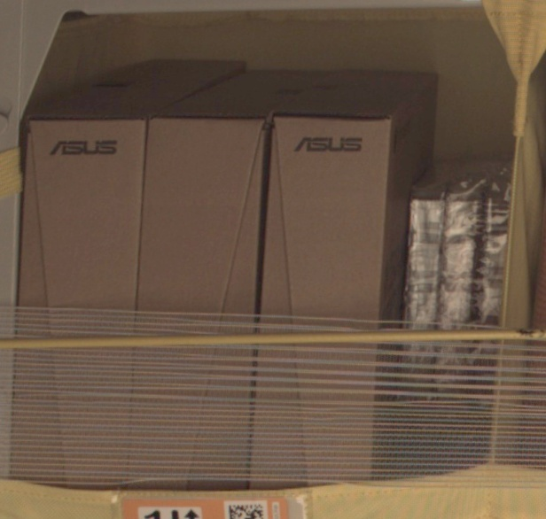
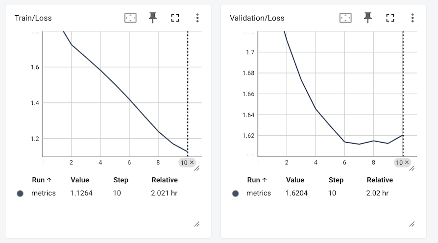
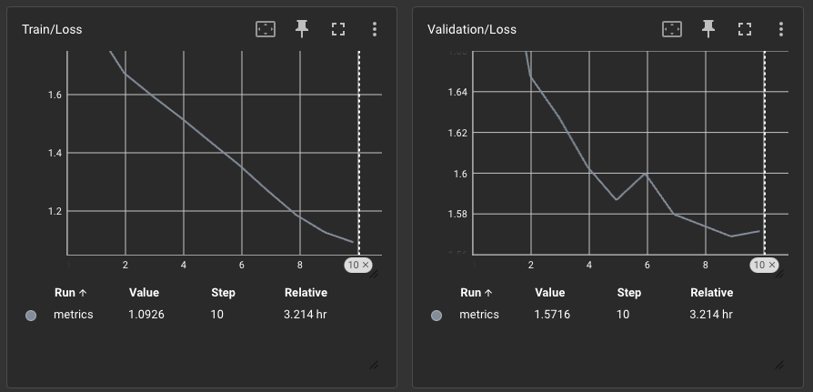

# Inventory Monitoring at Distribution Centers

## Problem definition

One of the biggest challenges in distribution centers is inventory level monitoring. 
Lack of knowledge about current goods level can lead to delivery delays and incur additional costs for distribution centers. 
This project aims to address this problem by preparing solution to automate this process.
It proposes machine learning based solution that predicts number of items in bin on provided image.

## Dataset

This project utilizes [Amazon Bin Image Dataset [1]](https://registry.opendata.aws/amazon-bin-imagery/).
It's publicly available dataset distributed under *Creative Commons Attribution-NonCommercial-ShareAlike 3.0 United States (CC BY-NC-SA 3.0 US)* licence.
Dataset contains over 500 000 images of bins with items captured during normal operations in *Amazon Fulfillment Center*.
Additionally, for each image manifest file is supplemented that provides metadata: number of items in bins and other characteristics, like: name, size, weights, etc.
Dataset can be easily obtained from publicly available S3 Bucket **aft-vbi-pds**.

Performed analysis revealed that dataset contains **536 434** images and number of items in bins ranges from 0 objects to 209 objects.
Below plot depicts that number of items in bins in not uniformly distributed: 
dataset contains much more instances of images for smaller bins (less than 10) than for larger bins.

It can be observed that for larger bins, dataset misses images for some quantities (gaps above 100 on axis). 
Additionally, there are few quantities with only 1 or 2 images.

Despite identified unbalanced number of samples per quantity, no transformations were applied as remedy for this problem.
The reason for that is keeping target quantities in original units making error easily interpretable (especially while applying MAE error).
Additionally, 99% of images contain bins with up to 21 items, allowing to recognize large bins as edge cases.

Below image is coming from dataset. It depicts bin with 4 items:  

Four images were investigated to better understand dataset. Analysis allowed to conclude following facts:
* examined images are represented using RGB colour space
* size (width and height) of images varies, sizes of analysed images: (438x562), (616x586), (472x364), (355x537)
* all sampled images are JPEG files
* items in bins seem to be mostly cardboard or plastic packaging
* images contain items that are not inside bins like (elastic retention cords, turnbuckle, background)
* large bins (bins with a lot of items) usually contain a lot of tightly stacked small items (e.g. envelopes)
* for human, it's hard, or it's almost impossible to count items purely based on image
* some products may be obscured or barely visible

For training and evaluation purposes dataset was split into three dataset with below proportions:
* training subset **70 %**
* validation subset **15 %**
* test subset **15 %**

Images were randomly assigned to subsets, but proportions across number of items are remained: 
for each number of items in bins training subset contain 70%, validation 15% and test 15% of images for that number of items in bins.
Thanks to that all three subsets can have similar distributions and models can have ability to train on similar images that is supposed to make predictions.
There are 55 values of quantities for which dataset contain too few samples to remain these proportions.
These samples were randomly assigned to one of subsets. Below table shows metrics of subsets:

| Metric | Train   | Validation | Test   | Total   |
|--------|---------|------------|--------|---------|
| Total  | 375 503 | 80 465     | 80 466 | 536 434 |
| Mean   | 5.1070  | 5.1139     | 5.1021 | 5.1073  |
| Std    | 4.6238  | 4.6650     | 4.5578 | 4.6202  |
| Min    | 0       | 0          | 0      | 0       |
| 25%    | 3       | 3          | 3      | 3       |
| 50%    | 4       | 4          | 4      | 4       |
| 75%    | 6       | 6          | 6      | 6       |
| Max    | 209     | 167        | 173    | 209     |

All these subset were created once and kept fixed for all proposed solutions.

On provided images following transformation were performed:
* training:
  * resizing to 224x224
  * randomly horizontally flipped
  * applied Colour Jittering (brightness: 0.1, contrast: 0.1, saturation: 0.1)
  * normalized across RGB-channels with following mean-std pairs
    * R channel: mean: 0.485, std: 0.229
    * G channel: mean: 0.456, std: 0.224
    * B channel: mean: 0.406, std: 0.225
* testing and validation:
  * resizing to 224x224
  * normalized across RGB-channels with following mean-std pairs
    * R channel: mean: 0.485, std: 0.229
    * G channel: mean: 0.456, std: 0.224
    * B channel: mean: 0.406, std: 0.225

Justifications:
* images were resized to 224x224 since this is standard images size for ResNet, 
  all images must have the same width and height values to leverage mini-batching,
  this transformation will lead to geometric squashing, altering aspect radio, but that will not disable solving main problem - counting objects 
* for data augmentation images from trainset are randomly horizontally flipped allowing to introduce more variations for positions of items
* colour jittering is used for data augmentation, images from training are randomly changed with up to 10% of brightness, contrast and saturation of image making model less sensitive to these properties
* additionally, mini-batches were normalized across RGB channels, applied values are broadly used while dealing with vision models

## Solutions

From technical point of view, problem to be solved is a regression problem - for provided image solution needs to provide number of items detected in bin.
Since this problem requires image processing, the best option is to employ one of popular pre-trained vision models.

As a foundation for both of proposed solutions ResNet architecture was selected [2]. 
It's one of the most popular vision model designed to solve image classification problems. 
Its characteristics - residual networks - allowed to reduce vanishing gradient problem while still being relatively deep network.
Original paper proposes multiple versions that differs with number of layers:
- ResNet18
- ResNet34
- ResNet50
- ResNet101
- ResNet152

First proposed solution is baseline model. It employs the lightest variant of ResNet architecture: **ResNet-18**. 
Since this model was primarily built to solve image classification problem, there are required adjustments to enable it to solve regression problem:
- classification head needs to be replaced by dense layer with single numeric output.

Second solution employs bigger version of that architecture **ResNet-101**. 
To enable this model to solve regression problem the same architecture changes were applied as for baseline model. 

Both models were trained in multi-instance SageMaker Training job utilizing PyTorch framework that enables Distributed Data Parallel (DDP):
- copies of model are stored on all nodes
- training and validation subsets are split across nodes 
- forward and backward phases are run independently for nodes
- weights are updated based on averaged gradient changes from all nodes

For training, pre-trained version of these ResNet variants were obtained from PyTorch library. 
Both models were pre-trained on the ImageNet-1K (ILSVRC 2012) dataset.
Weights of last layer of backbone (layer4) and introduced dense layer were trained, while rest of weights were frozen. 
Usually, first layers in vision models are responsible for activating for simple signals (like vertical or horizontal edges, colours).
Going deeper high level features are extracted (like contours). Therefore, first layers don't require training anymore.
**ResNet** was trained for image classification where usually it's important to identify object that dominates on image.
Since our problem is object counting, sensitivity for many objects on provided image is required. 
Training last dense layer together with last convolutional layer of backbone network should enable model to provide more accurate predictions.

Since predicted values (quantities) are integers ranging between 0 - 209, alternatively this problem could be recognized as classification problem.
However, typical approaches to classification problem doesn't allow to capture correlations between labels. 
In regression, correlation between 2 and 4 items in bin is clearly represented, while in classification these two are distinct classes with no correlation.

For inference to get the final predications, predicted values are rounded to closest non-negative integer.

## Training procedure

Training was performed on two SageMaker instances: `ml.g4dn.xlarge`. 
This is the cheapest instance that provides GPU capabilities offering **NVIDIA T4 GPU with 16 GB vRAM**, **4 vCPUs** and **16 GiB memory**.

During training phase, following hyperparameters were used:

| Hyperparameter                                    | Value                                |
|---------------------------------------------------|--------------------------------------|
| Mini batch size                                   | 256 (128 per instance)               |
| Number of epochs                                  | 10                                   |
| Optimizer                                         | Adam                                 |
| Learning rate                                     | 0.001                                |
| Early stopping after n epochs without improvement | 3                                    |
| Loss function                                     | Mean Absolute Error (torch *L1Loss*) |
| Learning Rate decreasing strategy                 | Cosine Annealing                     |

Above values of hyperparameters are typical as starting value for vision problem. 
Number of epochs was set to 10 to balance performance gains and costs (dealing with full half million dataset takes time which costs more).
Additionally, early stopping procedure was implemented: if loss function value on validation dataset does not decrease then training is stopped after n epochs without improvement.
That should allow to save time and money when next iterations don't conclude with performance gains.
Additionally, in order to reduce learning rate value Cosine Annealing was employed. 
It gradually reduces the learning rate value following a cosine function. 
The maximum annealing period was set to 10 (number of epochs) and minimum learning rate was set to $10^{-6}$.
This configuration allows to improve convergence stability and final model performance.

As loss function **Mean Absolute Error** was selected as it's one of classical choices for regression problems.
It can be easily interpreted since it's expressed in the same unit as predicted values. 
Additionally, it's not sensitive to outliers as Mean Squared Error, for which errors are squared.

Below table depicts basic characteristics about training procedure:

| Model      | Training time | Early stopped | Best model reached at n epoch |
|------------|---------------|---------------|-------------------------------|
| ResNet-18  | 2h 24m        | No            | 7                             |
| ResNet-101 | 3h 44m        | No            | 9                             |

In both cases training took more than 2 hours and none of them was stopped as a result of activating early stopping procedure.
Below plots shows loss functions values over epochs for both training and validation phases for both models.
In terms of interpretation of below plots, it's important that for training predicted values were not rounded to nearest non-negative integer.
The goal of that approach is to avoid problems with optimizing weights in backpropagation phase (the rounding operation is non-differentiable).

Upper plot depicts loss function change for ResNet18, while second plot is for ResNet101.
For both models, training loss consistently decreases. 
None of these plots indicates that model exhausted its capabilities (value didn't stop decreasing).
Most probably having more training epoch would allow to get even better training loss value. 

However, reaching the lowest value of training loss is not ultimate goal. 
It's important to see how model performs on data it did not see - that's the goal of validation subset.
In case of validation loss, performance gains can also be observed. Until epoch 5-6 validation error decreases. 
Then it starts to fluctuate. For ResNet18 it even starts growing at epoch 8. 
In case of ResNet101, error gets worse at 6 epoch, and then it starts improving again.

This phenomena can be explained by fact that model starts to overfit (model stop generalizing and tries to memorize training set).
Another more likely reason can be explained by different definition of these metrics: training metrics is not rounded to get nearest non-negative integer.
In such case training loss would consistently decrease (which is observed on these charts) and validation loss would decrease in discrete steps (to confirm that more epochs would be required).

The best models (based on validation dataset) were achieved at epoch 7 (Resnet-18) and epoch 9 (ResNet-101). 
For these models following errors were reported on validation dataset: 1.61 and 1.57, which says that on average these models' predications are off by about 1.6 item for every image.

## Evaluation

In order to evaluate performance of these solutions, test subset with 80,466 images is utilized. 
For each of these solutions **AWS Sagemaker Transform Batch** Job is set up to calculate responses for all images from test subset.
Results of these computations allows to measure models' performances.

For evaluation purposes following metrics are utilized:
- **Mean Absolute Error (MAE)** which expresses errors as absolute differences between true and predicted values.
  It treats errors linearly, making it less sensitive to outliers. It's expressed in original unit:
$$
MAE = \frac{1}{N}\sum_{i=1}^{N}|y_i-\hat{y}_i|
$$

- **Root Mean Square Error (RMSE)** which is the square root of the average squared prediction errors. 
  It penalizes large prediction errors more heavily due to squaring. It's expressed in original unit:
$$
RMSE = \sqrt{\frac{1}{N}\sum_{i=1}^{N}(y_i-\hat{y}_i)^2}
$$

- **R squared ($R^2$)** measures how much of the variance in dataset is explained by the model.
$$
R^2 = 1 -
\frac{\sum_{i=1}^{N}(y_i-\hat{y}_i)^2}
{\sum_{i=1}^{N}(y_i-\bar{y})^2}
$$
  When:
   - value of $R^2$ = 1, then it means that all the variance in dataset is explained
   - value of $R^2$ = 0, then model performs same as model predicting mean of actual values
   - value of $R^2$ < 0, then model performs worse than model predicting mean of actual values

- $y_i$ – actual item count.
- $\hat{y}_i$ – predicted item count.
- $\bar{y}$ – mean of actual values.
- $N$ – number of observations.
  
For problem to solve:
- MAE allows to get easily interpretable metrics (not being sensitive to outliers) that defines average error on whole dataset 
- Since RMSE penalises large errors heavier, this metric should allow to describe impact of large errors (which can be observed for large bins for which dataset contains less samples) 
- $R^2$ allows to measure models' explanatory performance relative to a mean-value baseline

For comparison purposes dummy model that predicts for all bins median (4) was introduced. 
It allows to confirm that more complex models are really worth effort.

Performed procedure allowed to obtain following results:

| Model       | MAE    | RMSE   | R^2     |
|-------------|--------|--------|---------|
| ResNet-18   | 1.6120 | 3.3958 | 0.4449  |
| ResNet-101  | 1.5610 | 3.2467 | 0.4926  |
| Dummy model | 2.6234 | 4.6891 | -0.0585 |

Above results indicates that both trained models perform better than dummy model predicting median value for all samples from test set.
Values of MAE and RMSE are much smaller for ResNet models. For dummy model $R^2$ value is below zero, which means that dummy model explains dataset variance worse than model returning mean.

Above metrics consistently indicate that ResNet-101 perform better than ResNet-18. 
On average difference between predictions is ~ 0.05 item.

Interestingly, for both models RMSE value is much higher than MAE (more than 2 times). 
Since RMSE penalizes larger errors heavier, mentioned fact may suggest that models do not perform well for larger bins (bins with a lot of items).
It might be caused by fact that dataset contains not enough data samples for such quantities. 
To address that issue, more samples would need to be gathered for such cases. 
Alternatively, strategy for data sampling could be improved to sample images with quantities for which dataset contains fewer samples.
Also, it might be worth to investigate how often such large bins occur. 
Maybe it's an edge case, and it's fine to accept risk of providing bad estimate for large items.  

For both models, $R^2$ indicates that 44%-49% of test subset variance is explained by models.

Additionally, paired significant test was performed to statistically prove that obtained ResNet-101 performs better than ResNet-18.
*Wilcoxon signed-rank* test was utilized, which makes a hypothesis that there is no difference between median of two populations.
For this purpose, absolute error was applied for true and predicted values for both models and obtained errors were used as input to test.
Test allowed to obtain $p = 2.5981 × 10^{-20}$ which is less than assumed  $\alpha = 0.001$, null-hypothesis stating that medians of both populations (errors) are the same
can be rejected. Therefore, there is statistical difference between errors made by these models. 
Since other metrics indicates that ResNet-101 performs better than ResNet-18, it provides strong statistical evidence that ResNet-101 preforms better than ResNet-18

It's worth to take into account complexity of two models. ResNet-101 contains ~44.5M parameters while ResNet-18 has ~11.7M parameters.
Due to that fact training time and more importantly inferences requires more computational resources to process single request for ResNet-101 than ResNet-18,
it's important to find appropriate balance between accuracy of provided prediction and cost of generating that prediction.

## Coding engineering complications

While working on this project engineering complication occurred:  
1. **Access denied while pulling dataset from publicly available S3 bucket**.   
   To address this issue new IAM policy was created and attached to IAM role used by SageMaker Studio. IAM policy allows to *GetObject*s and *ListBucket* that stores Amazon Bin Dataset.
2. **Too slow extraction of quantities for images**  
   Primarily interactive Glue sessions were created to pull and process manifest files. However, due to numerous tiny files that solution did not perform well too.
   Therefore, Python script was prepared to benefit from parallel processing by employing ThreadPoolExecutor. Additionally, connection pool size was increased to resolve bottlenecks and `orjson` library was employed for efficient JSON parsing
3. **How to store dataset so it can be easily imported by built-in Pytorch datasets**  
   For this problem it was decided to use structure used by *ImageFolder* which requires to put all images in directory of name of class.
   Standard implementation of ImageFolder was extended to provide true value quantity instead of index of class.
4. **Preparing parametrized script for training and evaluation**  
   In order to avoid code duplication, parametrized script was prepared that allows to use any variant of ResNet.
   ResNet option is selected by passing environment variable to container.

## Summary

As part of this project ResNet architecture was employed to solve object counting problem. 
Architecture was adjusted to support regression problem. Two variants (*ResNet-18* and *ResNet-101*) were fine-tuned.
Obtained results indicate that on average obtained models' predictions are off by about 1.5 items. 
That result might sound to be not good enough for production environment since expected MAE value is below 1. 
However, taking into account complexity of images (it's hard for human's eye to correctly count items on images from dataset),
obtained results are quite decent.

Following direction could be explored to seek for performance gains:
* Using strategy that takes into account quantity imbalance in dataset, so predictions for larger bins can be improved
* Performing training a little longer, since performed analysis revealed that model did not stop improving (that will require increasing $T$ value for Cosine Annealing Learning Rate Scheduler, it should be set to number of epochs)
* Hyperparameters tuning

In this project, *AWS SageMaker* services was utilized:
- AWS SageMaker Studio as web-based IDE
- S3 Bucket to store dataset
- AWS SageMaker Jobs to train 
- AWS SageMaker Batch Transform Job to retrieve responses for test subset for models' evaluation

## Literature

[1] *Amazon Bin Image Dataset* was accessed on *2026-11-17* from https://registry.opendata.aws/amazon-bin-imagery  

[2] Kaiming He, Xiangyu Zhang, Shaoqing Ren, Jian Sun: Deep Residual Learning for Image Recognition, 
https://doi.org/10.48550/arXiv.1512.03385
