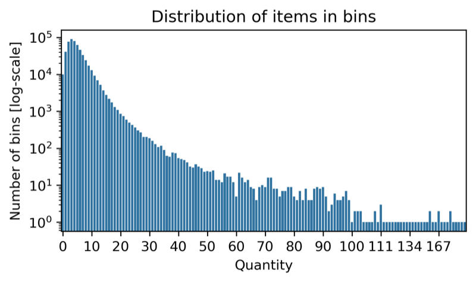

# Inventory Monitoring at Distribution Centers

## Problem definition

One of the challenges in distribution centers is inventory level monitoring.
This project aims to prepare solution that would allow to automate this process.
Based on provided image of bin, solution is supposed to provide number of objects in bin.

## Dataset

This project utilizes [Amazon Bin Image Dataset [1]](https://registry.opendata.aws/amazon-bin-imagery/).
It's publicly available dataset distributed under *Creative Commons Attribution-NonCommercial-ShareAlike 3.0 United States (CC BY-NC-SA 3.0 US)* licence.
Dataset contains over 500 000 images of bins with items captured during normal operations in *Amazon Fulfillment Center*.
Additionally, for each image manifest file is supplemented that provides metadata: number of items in bins and other characteristics, like: name, size, weights, etc.
Dataset can be easily obtained from publicly available S3 Bucket **aft-vbi-pds**.

Performed analysis reveled that dataset contains 536 4343 images and number of items in bins ranges from 0 objects to 209 objects.
Below plot depicts that number of items in bins in not uniformly distributed: dataset contains much more instances of images in which number of items in bins is quite low (below 50) than for bins with a lot of objects in bins.

For training and evaluation purposes dataset was split into three dataset with below proportions:
* training subset **70 %**
* validation subset **15 %**
* test subset **15 %**

All these subset were created once and kept fixed for all proposed solutions.

Images were randomly assigned to subsets, but proportions across number of items are remained: 
for each number of items in bins training subset contain 70%, validation 15% and test 15% of images for that number of items in bins.

On provided images following transformation were performed:
* training:
  * resizing to 224x224 (since that's requirement of ResNet models)
  * randomly horizontally and vertically flipped for data augmentation
  * applied Colour Jittering for brightness, contrast and saturation insensitivity
  * normalized across RGB-channels with following mean-std pairs
    * R channel: mean: 0.485, std: 0.229
    * G channel: mean: 0.456, std: 0.224
    * B channel: mean: 0.406, std: 0.225
* testing:
  * resizing to 224x224 (since that's requirement of ResNet models)
  * normalized across RGB-channels with following mean-std pairs
    * R channel: mean: 0.485, std: 0.229
    * G channel: mean: 0.456, std: 0.224
    * B channel: mean: 0.406, std: 0.225

## Solutions

Problem to solve is regression problem: for provided image solution needs to provide number of items detected in bin.
Since this problem requires image processing, the best solution is to use pre-trained vision models.
This project proposed two solutions.

First solution is baseline model. It employs popular vision model **ResNet-18**. 
Since this model was primarily built to solve image classification problem, model needs to be adjusted for regression:
classification head is replaced by dense layer with one numeric output. 
For training, all weights of backbone part are frozen and only last layer is trainable.
Second solution employs bigger version of that architecture **ResNet-101** while keeping the same architecture changes 
as baseline model. Both models were trained in multi-node SageMaker environment utilizing PyTorch framework:
models were stored on all nodes, while splitting training and validation subsets across nodes, 
running forward and backward phases independently and applying averaged gradient changes on models.
For inference, predicted value should be rounded to closest non-negative integer.
For both cases below hyperparameters were utilized:

| Hyperparameter                                    | Value |
|---------------------------------------------------|-------|
| Mini batch size                                   | 512   |
| Number of epochs                                  | 5     |
| Learning rate                                     | 0.003 |
| Early stopping after n epochs without improvement | 2     |

## Evaluation

In order to evaluate performance of these solutions, test subset with 80,596 images is utilized. 
For each of these solutions **AWS Sagemaker Transform Batch** Job is set up to calculate responses for all images from test subset.
Results of these computations allows to measure performances.

For evaluation purposes following metrics are utilized:
- Mean Absolute Error (MAE)
- Root Mean Square Error (RMSE)
- R squared (R^2)

These metrics are typical for regression problems.

Above procedure allowed to obtain following results:

| Model      | MAE    | RMSE   | R^2    |
|------------|--------|--------|--------|
| ResNet-18  | 2.3564 | 5.4390 | 0.0909 |
| ResNet-101 | 2.2805 | 5.3981 | 0.1046 |

First metric (MSE) shows that obtained models make mistakes. The Mean Absolute Error for *ResNet18* is 2.36, while for *ResNet101* is 2.28.
On average predictions are off by about 2-3 items. While for large bins (above 100 items) this might be minor error, for small bins (1-10 items) it's quite significant.

Second metric (Root Mean Squared Error) reports 5.44 and 5.40 for *ResNet18* and *ResNet101* respectively. 
Because RMSE squares individual errors before averaging, it penalizes larger mistakes heavier than MSE.
This suggests that both models may struggle more with larger bins where bigger errors can occur.

The final metric indicates *ResNet18* explains only ~9.1% of test subset invariance, while *ResNet101* explains ~10.5% of test invariance.

All metrics consistently indicates that bigger model *ResNet101* performs slight better than smaller one *ResNet18*.

## Summary

As part of this project, two solutions were built to solve inventory level monitoring problems. 
Both solutions employ ResNet architecture (*ResNet-18* and *ResNet-101*). 
Results indicate that on average obtained models' predictions are off by 2-3 items.
*AWS SageMaker* service was utilized to train and evaluate all solutions.
